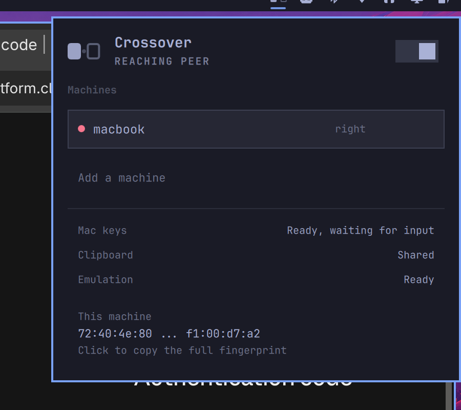

# Crossover

Drive your Omarchy machine with the mouse and keyboard of the computer next to
it. Push the cursor off the edge of one screen and it lands on the other, the
clipboard follows, and a Mac keyboard stops fighting you about which key is
Control.

It is Universal Control, for a Linux box you actually own.



## What it does

- **One mouse and keyboard, two machines.** Built on
  [lan-mouse](https://github.com/feschber/lan-mouse), which is packaged in Arch
  `extra` and encrypts everything it sends.
- **Shared clipboard.** Copy on the Mac, paste on Omarchy, and back. lan-mouse
  does not do this; `crossover-clipd` adds it over its own mutually
  authenticated TLS connection.
- **Mac keyboard translation.** Cmd-C, Cmd-Tab and Cmd-L behave the way your
  fingers expect, applied only to the incoming virtual keyboard so the keyboard
  physically attached to the Omarchy box is untouched.
- **Pairing that shows you the fingerprint.** An unknown machine asking to
  connect gets a confirmation card, not a silent accept.
- **Honest about which way the link is up.** The two directions are authorized
  separately, so a Mac can be driving this screen while your own link back to
  it is still refused. Machines currently driving you are shown as such, even
  ones you never configured as peers.
- **A seam.** The screen edge glows briefly when the cursor crosses in, so a
  pointer arriving from nowhere does not feel like a glitch.

## Quick start

Three commands, one on each machine plus a firewall rule.

```bash
# 1. On Omarchy: install the plugin and lan-mouse
omarchy plugin add https://github.com/nwilkens/omarchy-crossover.git
omarchy plugin enable nwilkens.crossover --section right
sudo pacman -S lan-mouse

# 2. On Omarchy: open the ports on your LAN (ufw blocks them by default)
curl -fsSL https://raw.githubusercontent.com/nwilkens/omarchy-crossover/main/scripts/open-firewall.sh \
  | bash -s -- 192.168.1.0/24

# 3. On the Mac: everything, in one line
curl -fsSL https://raw.githubusercontent.com/nwilkens/omarchy-crossover/main/scripts/install-macos.sh \
  | bash -s -- <omarchy-ip> --ssh you@<omarchy-ip>
```

Open the Crossover panel on the bar and it shows you step 3 with your own
address already filled in, so you never have to go find it. Approve the
fingerprint on both ends, grant Lan Mouse the macOS permissions it asks for,
and push your cursor off the edge.

## Requirements

- Omarchy 4 (Quattro) with `omarchy-shell`
- `lan-mouse` (`sudo pacman -S lan-mouse`)
- `crossover-clipd`, only if you want the shared clipboard

## Install

```bash
omarchy plugin add https://github.com/nwilkens/omarchy-crossover.git
omarchy plugin enable nwilkens.crossover --section right
```

If `lan-mouse` is missing the panel says so and hands you the command.

### The clipboard helper (Omarchy side)

The plugin cannot install binaries: `omarchy plugin add` deliberately never
runs an install hook. Grab a release build, or compile it yourself:

```bash
# prebuilt
curl -sSL https://github.com/nwilkens/omarchy-crossover/releases/latest/download/crossover-clipd-x86_64-linux \
  -o ~/.cargo/bin/crossover-clipd && chmod +x ~/.cargo/bin/crossover-clipd

# or from source
cargo install --path ~/.config/omarchy/plugins/nwilkens.crossover/clipd
```

## Open the ports first

Omarchy ships with `ufw` enabled, and it blocks both ports by default. A
blocked port is indistinguishable from a peer that is not answering, so do this
before you start debugging pairing:

```bash
./scripts/open-firewall.sh 192.168.1.0/24   # your LAN, not 0.0.0.0/0
```

That opens 4242 (lan-mouse, UDP and TCP) and 4243 (clipboard, TCP) to that
subnet only. Do the same on the other machine if it firewalls inbound traffic;
macOS will prompt the first time instead.

## Pairing

Two independent pairings, one for input and one for the clipboard. Both are
fingerprint based, and neither trusts on first use.

**Input.** Start Crossover from the bar, add the other machine, and set which
edge it sits on. The first connection attempt raises a confirmation card
showing the peer's fingerprint. Compare it with the one that machine shows and
approve it.

**Clipboard.** On each machine:

```bash
crossover-clipd fingerprint          # read this one
crossover-clipd pair <other-machine-fingerprint>
crossover-clipd add-peer <other-machine-address>
```

Then leave it running. On Omarchy the plugin starts it for you; on macOS the
setup script installs a LaunchAgent.

## Setting up the Mac side

One command on the Mac. No repo to clone, no Rust toolchain, no compiling:

```bash
curl -fsSL https://raw.githubusercontent.com/nwilkens/omarchy-crossover/main/scripts/install-macos.sh \
  | bash -s -- 10.0.5.1 --ssh you@10.0.5.1
```

Replace `10.0.5.1` with your Omarchy machine's address. The Crossover panel
shows you this exact line, with the address already filled in, under
**Set up another machine**.

The `--ssh` part is optional and only used to pair the clipboard in both
directions without copy-pasting fingerprints between machines. Drop it and the
script prints the fingerprints for you to exchange by hand.

It downloads the official `Lan Mouse.app`, clears the Gatekeeper quarantine
flag that otherwise makes an ad-hoc signed app look corrupt, installs the
clipboard helper and its LaunchAgent, points Lan Mouse at your Omarchy machine,
and pairs the clipboard in both directions over ssh.

Drop `--ssh` and it prints the fingerprints for you to exchange by hand.
Use `--position right` if the Omarchy machine sits to the right of your Mac.

That installs lan-mouse and the clipboard agent and walks you through pairing.
Two things it cannot do for you:

1. macOS will not let anything read your mouse and keyboard until you grant
   permission. System Settings > Privacy & Security, under **Accessibility**
   and again under **Input Monitoring**, adding `~/.cargo/bin/lan-mouse`.

   The grant is per binary, and a LaunchAgent gets no prompt: started by
   launchd it simply logs `accessibility permission is required` and gives up.
   So run it once from Terminal first, approve both prompts, then load the
   agent:

   ```bash
   lan-mouse --emulation-backend mac-os daemon   # approve the prompts, Ctrl-C
   launchctl kickstart -p gui/$UID/com.nwilkens.crossover.lan-mouse
   ```
2. lan-mouse needs to know which edge the Omarchy machine sits on. Set that in
   the lan-mouse window.

## Mac keyboard translation

Off by default, because swapping Ctrl and Super is right when a Mac is driving
and wrong when another Linux box is. Turn it on from Setup > Plugins once your
peer is a Mac.

A Mac sends Command as Super. Omarchy binds Super to its own shortcuts, so
without translation Cmd-C opens a workspace instead of copying.

Crossover applies `ctrl:swap_lwin_lctl` to the virtual keyboard that lan-mouse
creates, and to nothing else. Hyprland 0.56 refuses `hyprctl keyword` under its
Lua parser, so the rule is registered through the Lua device API instead, which
also means it applies the moment the device appears:

```
hyprctl eval 'hl.device({ name = "hl-virtual-keyboard-lan-mouse",
                          kb_options = "<your options>,ctrl:swap_lwin_lctl" })'
```

Your existing `input:kb_options` are read first and preserved, so a compose key
stays a compose key. Nothing is written to your Hyprland config; the rule is
applied at runtime and disappears when you turn the setting off.

Cmd becomes Ctrl, and the Mac's Control key becomes Super, which is where you
reach for Omarchy's own bindings. The keyboard attached to the Omarchy machine
keeps its normal layout.

Crossover applies the rule, reads the device back from `hyprctl devices`, and
reports what it actually finds: **"Ready, waiting for input"** before the
virtual keyboard exists, **"Cmd acts as Ctrl"** once the compositor confirms
the rule on the live device, and **"Compositor refused the rule"** if it did
not take. It never claims a translation that is not happening.

## Settings

Set these from Setup > Plugins, or inline on the widget's entry in
`~/.config/omarchy/shell.json`.

| Key | Default | What it does |
| --- | --- | --- |
| `macKeyboard` | `false` | Translate Cmd to Ctrl on the incoming keyboard |
| `clipboardSync` | `true` | Run the clipboard helper alongside the daemon |
| `seamIndicator` | `true` | Glow the screen edge on a crossing |
| `autostart` | `true` | Start lan-mouse with the shell |
| `emulationBackend` | `wlroots` | lan-mouse emulation backend |

`wlroots` is the right backend on Hyprland today. The portal-based backends
depend on an InputCapture portal that Hyprland has not shipped yet.

## In the panel

| Key | Action |
| --- | --- |
| Enter | Toggle the selected machine, or approve a pairing |
| `p` | Cycle which edge the selected machine sits on |
| `n` | Add a machine, by hostname or IP |
| `s` | Start or stop sharing |
| `c` | Copy this machine's fingerprint |
| `r` | Refresh |
| Delete | Remove the selected machine |

## When something is wrong

The panel tries to say what is actually happening rather than showing a
spinner. lan-mouse and the clipboard helper are both supervised and restarted
if they die; if either keeps exiting, the panel stops respawning it, shows the
last line of its stderr, and offers a retry button instead of looping forever.

A helper left running by a previous shell is adopted rather than fought with,
which otherwise shows up as a clipboard that refuses to start because the port
is already bound.

## Security

The clipboard carries passwords, so `crossover-clipd` is built to be boring
about it:

- Both ends present a certificate and pin the other's SHA-256 fingerprint.
  Unknown peers are refused. There is no trust-on-first-use path.
- Traffic is TLS 1.3. The private key is written `0600` and never leaves the
  machine.
- A selection marked `x-kde-passwordManagerHint` is never transmitted, which is
  the hint password managers set for exactly this reason. On macOS, `arboard`
  does not expose pasteboard types yet, so the equivalent
  `org.nspasteboard.ConcealedType` check is not in place on that side.
- Payloads are size capped, digest checked, and the receiver allocates only
  after the cap check, never on the sender's claimed length.
- Inbound sessions are limited so a peer cannot exhaust file descriptors.

Report anything that looks wrong by opening an issue.

## What this plugin actually runs

The marketplace scanner flags four capabilities in this repository. All four
are real, and here is exactly where each one lives.

**The plugin itself never runs `sudo`, and never installs anything.** The
`sudo pacman -S lan-mouse` you see in `Panel.qml` is a string rendered in the
panel and copied to your clipboard when you click it. You run it, or you do
not.

Processes the QML actually spawns, all as your own user:

| Command | Why |
| --- | --- |
| `lan-mouse ... daemon` | the input daemon it manages |
| `crossover-clipd run` | the clipboard helper, if installed |
| `hyprctl` | read monitors and devices, apply the keyboard rule |
| `wl-copy` | the click-to-copy actions in the panel |
| `which`, `sh -c`, `pgrep` | locate binaries, detect an already-running helper |
| `pkill -x crossover-clipd` | stop the clipboard helper when you switch it off |

The two shell scripts are **optional, run by you, and never invoked by the
plugin**:

- `scripts/open-firewall.sh` runs on the Omarchy machine and calls `sudo ufw`
  or `sudo firewall-cmd` to open ports 4242 and 4243 to one subnet you name. It
  reads service state with `systemctl is-active` to pick between the two; it
  does not start, stop, or enable any service.
- `scripts/install-macos.sh` runs **on macOS only** and never touches the
  Omarchy machine. It downloads the official `Lan Mouse.app` and the clipboard
  helper into your home directory, writes `~/.config/lan-mouse/config.toml`
  (backing up any existing file first), and installs a LaunchAgent.

Nothing is written outside `~/.config/lan-mouse`, `~/.config/crossover`, and
the plugin's own checkout. No sudoers changes. No bundled binaries in this
repository; the release binaries are built by GitHub Actions from the `clipd`
source here.

## How it works

```
  macOS                                  Omarchy / Hyprland
  ─────                                  ──────────────────
  lan-mouse (capture)  ── DTLS/UDP ──▶  lan-mouse (wlroots emulation)
                                                │
  crossover-clipd      ── TLS/TCP ───▶  crossover-clipd
  (NSPasteboard)                        (wlr-data-control)
                                                │
                                         Crossover (QML)
                                         bar widget + panel
```

The plugin is a control plane. It speaks lan-mouse's newline-delimited JSON
protocol on `$XDG_RUNTIME_DIR/lan-mouse-socket.sock`, so peer state, pairing
requests, and crossing events arrive as events rather than being polled.

Clipboard runs on its own connection rather than inside lan-mouse's, because
lan-mouse moves input over unreliable datagrams. That is the right shape for
pointer motion and the wrong one for a 2 MB paste, which is why upstream has
had clipboard support on its wishlist rather than in a release.

## Thanks

[lan-mouse](https://github.com/feschber/lan-mouse) by Ferdinand Schober does
the hard part: capturing input on macOS and emulating it on Wayland. Crossover
would be a much larger project without it.

## License

MIT
