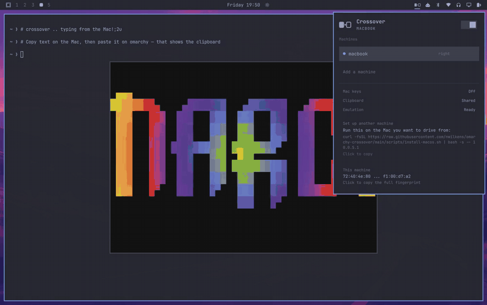

# Crossover

Drive your Omarchy machine with the mouse and keyboard of the computer next to
it. Push the cursor off the edge of one screen and it lands on the other, the
clipboard follows, and a Mac keyboard stops fighting you about which key is
Control.

It is Universal Control, for a Linux box you actually own.



*A Mac takes control of the Omarchy screen, the panel says so, and the keyboard
follows.*

## What it does

- **One mouse and keyboard, two machines.** Built on
  [lan-mouse](https://github.com/feschber/lan-mouse), which is packaged in Arch
  `extra` and encrypts everything it sends.
- **Shared clipboard.** Copy on the Mac, paste on Omarchy, and back. lan-mouse
  does not do this; `crossover-clipd` adds it over its own mutually
  authenticated TLS connection.
- **Mac keyboard translation.** Cmd-C, Cmd-Tab and Cmd-L behave the way your
  fingers expect, applied only to the incoming virtual keyboard so the keyboard
  physically attached to the Omarchy box is untouched.
- **Pairing that shows you the fingerprint.** An unknown machine asking to
  connect gets a confirmation card, not a silent accept.
- **Honest about which way the link is up.** The two directions are authorized
  separately, so a Mac can be driving this screen while your own link back to
  it is still refused. Machines currently driving you are shown as such, even
  ones you never configured as peers.
- **A seam.** The screen edge glows when another machine takes control, so a
  pointer arriving from nowhere does not read as a glitch. lan-mouse reports an
  entry once per connection rather than once per crossing, so this marks the
  handover rather than every trip across the boundary. Preview it any time with
  `omarchy-shell nwilkens.crossover testSeam left`.

## Quick start

```bash
# 1. On Omarchy: install the plugin and lan-mouse
omarchy plugin add https://github.com/nwilkens/omarchy-crossover.git
omarchy plugin enable nwilkens.crossover --section right
sudo pacman -S lan-mouse

# 2. On Omarchy: open the ports on your LAN (ufw blocks them by default)
curl -fsSL https://raw.githubusercontent.com/nwilkens/omarchy-crossover/v0.3.0/scripts/open-firewall.sh \
  | bash -s -- 192.168.1.0/24

# 3. On Omarchy: the clipboard helper, if you want a shared clipboard
#    (see "The clipboard helper" below for the checksum-verified commands)

# 4. On the Mac: everything else, in one line
curl -fsSL https://raw.githubusercontent.com/nwilkens/omarchy-crossover/v0.3.0/scripts/install-macos.sh \
  | bash -s -- <omarchy-ip>
```

Open the Crossover panel on the bar and it shows you step 4 with your own
address already filled in, so you never have to go find it. Approve the
fingerprint on both ends, grant Lan Mouse the macOS permissions it asks for,
and push your cursor off the edge.

Add `--ssh you@<omarchy-ip>` to step 4 to pair the clipboard automatically in
both directions. It needs step 3 done first, because it looks for
`crossover-clipd` on the Omarchy machine and stops if it is not there.

## Requirements

- Omarchy 4 (Quattro) with `omarchy-shell`
- `lan-mouse` (`sudo pacman -S lan-mouse`)
- `crossover-clipd`, only if you want the shared clipboard

## Install

```bash
omarchy plugin add https://github.com/nwilkens/omarchy-crossover.git
omarchy plugin enable nwilkens.crossover --section right
```

If `lan-mouse` is missing the panel says so and hands you the command.

`omarchy plugin add` clones the default branch and takes no ref, so the plugin
checkout tracks `main` and `omarchy plugin update` fast-forwards it. To fix the
plugin at a reviewed revision, pin the checkout with git afterwards:

```bash
git -C ~/.config/omarchy/plugins/nwilkens.crossover checkout v0.3.0
```

### The clipboard helper (Omarchy side)

The plugin cannot install binaries: `omarchy plugin add` deliberately never
runs an install hook. Grab a release build, or compile it yourself.

The download is verified before it becomes an executable on your PATH, so a
corrupt or substituted file is never installed:

```bash
set -e
V=v0.3.0
BASE=https://github.com/nwilkens/omarchy-crossover/releases/download/$V
TMP=$(mktemp -d)
curl -fsSL "$BASE/crossover-clipd-x86_64-linux" -o "$TMP/crossover-clipd"
curl -fsSL "$BASE/SHA256SUMS" | grep crossover-clipd-x86_64-linux \
  | sed "s#crossover-clipd-x86_64-linux#$TMP/crossover-clipd#" | sha256sum -c -
mkdir -p ~/.local/bin
install -m755 "$TMP/crossover-clipd" ~/.local/bin/crossover-clipd
rm -rf "$TMP"
```

Or from source at the same tag:

```bash
git clone --branch v0.3.0 --depth 1 https://github.com/nwilkens/omarchy-crossover.git /tmp/crossover-src
cargo install --path /tmp/crossover-src/clipd --locked
```

What that does and does not give you: the binary and its checksum both come
from one release tag, so a corrupted or swapped download is caught. A git tag
is still a movable ref that the repository owner can re-point, and the checksum
file is published unsigned beside the binary, so this detects corruption rather
than proving provenance. For a hard guarantee, check out a commit SHA and build
from source.

## Open the ports first

Omarchy ships with `ufw` enabled, and it blocks both ports by default. A
blocked port is indistinguishable from a peer that is not answering, so do this
before you start debugging pairing:

```bash
./scripts/open-firewall.sh 192.168.1.0/24   # your LAN, not 0.0.0.0/0
```

That opens 4242 (lan-mouse, UDP and TCP) and 4243 (clipboard, TCP) to that
subnet only. Do the same on the other machine if it firewalls inbound traffic;
macOS will prompt the first time instead.

## Pairing

Two independent pairings, one for input and one for the clipboard. Both are
fingerprint based, and neither trusts on first use.

**Input.** Start Crossover from the bar, add the other machine, and set which
edge it sits on. The first connection attempt raises a confirmation card
showing the peer's fingerprint. Compare it with the one that machine shows and
approve it.

**Clipboard.** On each machine:

```bash
crossover-clipd fingerprint          # read this one
crossover-clipd pair <other-machine-fingerprint>
crossover-clipd add-peer <other-machine-address>
```

Then leave it running. On Omarchy the plugin starts it for you; on macOS the
setup script installs a LaunchAgent.

## Setting up the Mac side

One command on the Mac. No repo to clone, no Rust toolchain, no compiling:

```bash
curl -fsSL https://raw.githubusercontent.com/nwilkens/omarchy-crossover/v0.3.0/scripts/install-macos.sh \
  | bash -s -- 10.0.5.1
```

Replace `10.0.5.1` with your Omarchy machine's address. The Crossover panel
shows you this exact line, with the address already filled in, under
**Set up another machine**.

It downloads the official `Lan Mouse.app` (pinned to a tag and checked against
a SHA-256 recorded in the script), clears the Gatekeeper quarantine flag that
otherwise makes an ad-hoc signed app look corrupt, installs the clipboard
helper and one LaunchAgent for it, and points Lan Mouse at your Omarchy
machine.

Options:

- `--ssh you@10.0.5.1` pairs the clipboard in both directions instead of making
  you copy fingerprints between machines. It runs `crossover-clipd` commands on
  the Omarchy machine over ssh, so install the helper there first, and note it
  does write pairing state on that machine.
- `--position right` if the Omarchy machine sits to the right of your Mac.

Then one thing only you can do: **grant Lan Mouse permission**. macOS will not
let anything read your mouse and keyboard until you say so.

The installer opens the app so macOS prompts you. If it does not, add it by
hand under System Settings > Privacy & Security, in **Accessibility** and again
in **Input Monitoring**, choosing `/Applications/Lan Mouse.app`.

The grant is per application and launchd never shows the prompt, which is why
this installer runs Lan Mouse as a normal app rather than as a LaunchAgent. To
start it with you, add it under System Settings > General > Login Items.

Finally, approve the Omarchy machine's fingerprint in the Lan Mouse window, and
approve the Mac's fingerprint in the Crossover panel on the Omarchy side.

## Mac keyboard translation

Off by default, because swapping Ctrl and Super is right when a Mac is driving
and wrong when another Linux box is. Turn it on from Setup > Plugins once your
peer is a Mac.

A Mac sends Command as Super. Omarchy binds Super to its own shortcuts, so
without translation Cmd-C opens a workspace instead of copying.

Crossover applies `ctrl:swap_lwin_lctl` to the virtual keyboard that lan-mouse
creates, and to nothing else. Hyprland 0.56 refuses `hyprctl keyword` under its
Lua parser, so the rule is registered through the Lua device API instead, which
also means it applies the moment the device appears:

```
hyprctl eval 'hl.device({ name = "hl-virtual-keyboard-lan-mouse",
                          kb_options = "<your options>,ctrl:swap_lwin_lctl" })'
```

Your existing `input:kb_options` are read first and preserved, so a compose key
stays a compose key. Nothing is written to your Hyprland config; the rule is
applied at runtime and disappears when you turn the setting off.

Cmd becomes Ctrl, and the Mac's Control key becomes Super, which is where you
reach for Omarchy's own bindings. The keyboard attached to the Omarchy machine
keeps its normal layout.

Crossover applies the rule, reads the device back from `hyprctl devices`, and
reports what it actually finds: **"Ready, waiting for input"** before the
virtual keyboard exists, **"Cmd acts as Ctrl"** once the compositor confirms
the rule on the live device, and **"Compositor refused the rule"** if it did
not take. It never claims a translation that is not happening.

## Settings

Set these from Setup > Plugins, or inline on the widget's entry in
`~/.config/omarchy/shell.json`.

| Key | Default | What it does |
| --- | --- | --- |
| `macKeyboard` | `false` | Translate Cmd to Ctrl on the incoming keyboard |
| `clipboardSync` | `true` | Run the clipboard helper alongside the daemon |
| `seamIndicator` | `true` | Glow the screen edge on a crossing |
| `autostart` | `true` | Start lan-mouse with the shell |
| `emulationBackend` | `wlroots` | lan-mouse emulation backend |

`wlroots` is the right backend on Hyprland today. The portal-based backends
depend on an InputCapture portal that Hyprland has not shipped yet.

## In the panel

| Key | Action |
| --- | --- |
| Enter | Toggle the selected machine, or approve a pairing |
| `p` | Cycle which edge the selected machine sits on |
| `n` | Add a machine, by hostname or IP |
| `s` | Start or stop sharing |
| `c` | Copy this machine's fingerprint |
| `r` | Refresh |
| Delete | Remove the selected machine |

## When something is wrong

The panel tries to say what is actually happening rather than showing a
spinner. lan-mouse and the clipboard helper are both supervised and restarted
if they die; if either keeps exiting, the panel stops respawning it, shows the
last line of its stderr, and offers a retry button instead of looping forever.

A helper left running by a previous shell is adopted rather than fought with,
which otherwise shows up as a clipboard that refuses to start because the port
is already bound.

## Removing it

Nothing here is hidden, and all of it comes back out.

**On Omarchy**

Disabling or removing the plugin stops both daemons, because the plugin tears
them down when it is unloaded. The `pkill` line is belt and braces for the case
where the shell was killed rather than asked to stop:

```bash
omarchy plugin remove nwilkens.crossover
pkill -x crossover-clipd; pkill -x lan-mouse   # only if either is still up
sudo pacman -Rns lan-mouse                     # only if you want lan-mouse gone
rm -f ~/.local/bin/crossover-clipd ~/.cargo/bin/crossover-clipd
rm -rf ~/.config/crossover                     # identity and paired fingerprints
```

Stop the helper before deleting `~/.config/crossover`: a running daemon has
already loaded its identity into memory and keeps accepting paired peers until
it exits.

If you opened the firewall, take those rules back out with the same script:

```bash
curl -fsSL https://raw.githubusercontent.com/nwilkens/omarchy-crossover/v0.3.0/scripts/open-firewall.sh \
  | bash -s -- 192.168.1.0/24 --remove
```

Confirm with `sudo ufw status`; the script prints what remains rather than
assuming the deletions took.

Peers you added live in `~/.config/lan-mouse/config.toml`; delete it if you are
removing lan-mouse too. The Mac keyboard rule is applied at runtime and is
cleared when sharing stops, so there is nothing to undo in your Hyprland
config.

**On the Mac**

```bash
curl -fsSL https://raw.githubusercontent.com/nwilkens/omarchy-crossover/v0.3.0/scripts/uninstall-macos.sh \
  | bash -s -- --yes
```

That unloads and deletes the clipboard LaunchAgent, kills the processes,
removes `/Applications/Lan Mouse.app` and `~/.local/bin/crossover-clipd`,
restores any lan-mouse config it replaced, and clears its logs. Run it without
`--yes` from a terminal to be asked before the app and your paired identity are
deleted, or pass `--keep-lan-mouse` to leave the app in place.

If you used `--ssh` when installing, that also wrote pairing state on the
Omarchy machine. Undo it there with `rm -rf ~/.config/crossover`, or drop just
the Mac with `crossover-clipd revoke <mac-fingerprint>`.

Two things a script is not allowed to do for you: macOS keeps the
**Accessibility** and **Input Monitoring** entries after an app is deleted, so
remove "Lan Mouse" by hand under System Settings > Privacy & Security, and
remove it from **Login Items** if you added it there.

## Security

The clipboard carries passwords, so `crossover-clipd` is built to be boring
about it. What it does:

- Both ends present a certificate and pin the other's SHA-256 fingerprint.
  Unknown peers are refused in both directions. There is no trust-on-first-use
  path.
- Traffic is TLS, negotiated by rustls with TLS 1.3 and TLS 1.2 enabled. The
  private key is written `0600` and never leaves the machine.
- Payloads are size capped, digest checked, and the receiver allocates only
  after the cap check, never on the sender's claimed length.
- Inbound sessions are capped at eight, and a handshake gets a much shorter
  deadline than a completed exchange so an unauthenticated peer cannot sit on a
  slot for long.
- Approving a new machine requires the cursor to be on the approval card. A
  connection attempt can never redirect a keypress aimed at something else into
  granting trust, and a denied fingerprint stays denied for the session.

Where it is weaker than you might assume, stated plainly:

- **The password-manager check is best effort, not a guarantee.** On Linux a
  selection marked `x-kde-passwordManagerHint` is skipped, but the hint and the
  contents are read in two separate clipboard round trips, so a copy landing
  between them can still be sent. On macOS there is no check at all yet:
  `arboard` does not expose pasteboard types, so `org.nspasteboard.ConcealedType`
  is not consulted and passwords copied on the Mac are transmitted.
- **A received payload loses the hint.** The receiving side writes plain text,
  so a clipboard history manager there may persist it.
- **The eight-session cap is availability, not authentication.** A host on your
  subnet that opens sockets and never speaks can still make inbound sync stall
  until it stops.

If a shared clipboard for passwords is not a trade you want, set
`clipboardSync` to `false` and use Crossover for input only.

Report anything that looks wrong by opening an issue.

## What this plugin actually runs

The marketplace scanner flags four capabilities in this repository. All four
are real, and here is exactly where each one lives.

**The plugin itself never runs `sudo`, and never installs anything.** The
`sudo pacman -S lan-mouse` you see in `Panel.qml` is a string rendered in the
panel and copied to your clipboard when you click it. You run it, or you do
not.

Processes the QML actually spawns, all as your own user:

| Command | Why |
| --- | --- |
| `lan-mouse ... daemon` | the input daemon it manages |
| `crossover-clipd run` | the clipboard helper, if installed |
| `hyprctl` | read monitors and devices, apply the keyboard rule |
| `wl-copy` | the click-to-copy actions in the panel |
| `which`, `pgrep` | locate the helper, detect one already running |
| `sh -c` | two fixed pipelines: locating `crossover-clipd`, and reading this machine's LAN address with `ip`, `sed`, and `head` |
| `pkill -x crossover-clipd` | stop the clipboard helper when you switch it off |

Peer-supplied values (hostnames, addresses, fingerprints arriving over
lan-mouse's IPC socket) are never interpolated into any of these. Commands are
built as fixed argument arrays.

The three shell scripts are **optional, run by you, and never invoked by the
plugin**:

- `scripts/open-firewall.sh` runs on the Omarchy machine and calls `sudo ufw`
  or `sudo firewall-cmd` to open ports 4242 and 4243 to one subnet you name. It
  reads service state with `systemctl is-active` to pick between the two; it
  does not start, stop, or enable any service.
- `scripts/install-macos.sh` runs on macOS. With `--ssh` it also runs three
  `crossover-clipd` subcommands on the Omarchy machine over ssh (`fingerprint`,
  `pair`, `add-peer`), which write `~/.config/crossover` there.
- `scripts/uninstall-macos.sh` reverses the macOS installer.

What gets written, in full:

| Path | By |
| --- | --- |
| `~/.config/omarchy/plugins/nwilkens.crossover/` | `omarchy plugin add` |
| `~/.config/crossover/` (identity, paired fingerprints) | the clipboard helper, on either machine |
| `~/.config/lan-mouse/config.toml` | lan-mouse, and the macOS installer, which backs up an existing file |
| `/Applications/Lan Mouse.app` | the macOS installer |
| `~/.local/bin/crossover-clipd` | the macOS installer, and the documented Linux install |
| `~/Library/LaunchAgents/com.nwilkens.crossover.clipd.plist` | the macOS installer |
| `~/Library/Logs/crossover-clipd.log` | that LaunchAgent |
| ufw or firewalld rules for 4242 and 4243 | `open-firewall.sh`, only if you run it |

No sudoers changes. No binaries committed to this repository; the release
builds are produced by GitHub Actions from the `clipd` source here. Every item
above has a removal command in [Removing it](#removing-it).

## How it works

```
  macOS                                  Omarchy / Hyprland
  ─────                                  ──────────────────
  lan-mouse (capture)  ── DTLS/UDP ──▶  lan-mouse (wlroots emulation)
                                                │
  crossover-clipd      ── TLS/TCP ───▶  crossover-clipd
  (NSPasteboard)                        (wlr-data-control)
                                                │
                                         Crossover (QML)
                                         bar widget + panel
```

The plugin is a control plane. It speaks lan-mouse's newline-delimited JSON
protocol on `$XDG_RUNTIME_DIR/lan-mouse-socket.sock`, so peer state, pairing
requests, and crossing events arrive as events rather than being polled.

Clipboard runs on its own connection rather than inside lan-mouse's, because
lan-mouse moves input over unreliable datagrams. That is the right shape for
pointer motion and the wrong one for a 2 MB paste, which is why upstream has
had clipboard support on its wishlist rather than in a release.

## Thanks

[lan-mouse](https://github.com/feschber/lan-mouse) by Ferdinand Schober does
the hard part: capturing input on macOS and emulating it on Wayland. Crossover
would be a much larger project without it.

## License

MIT
